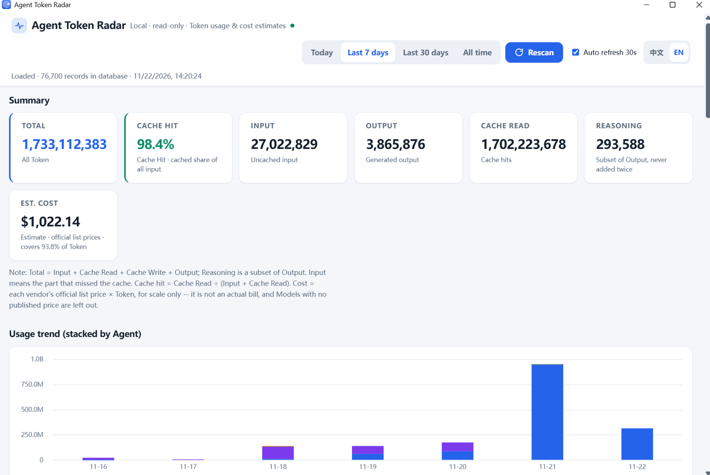
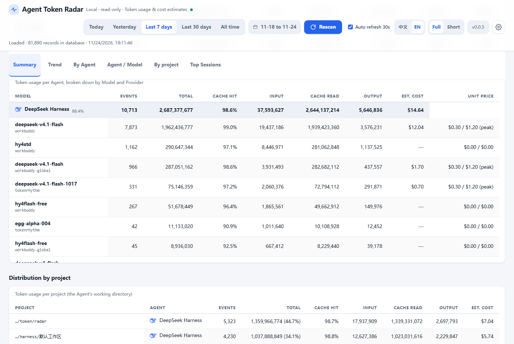
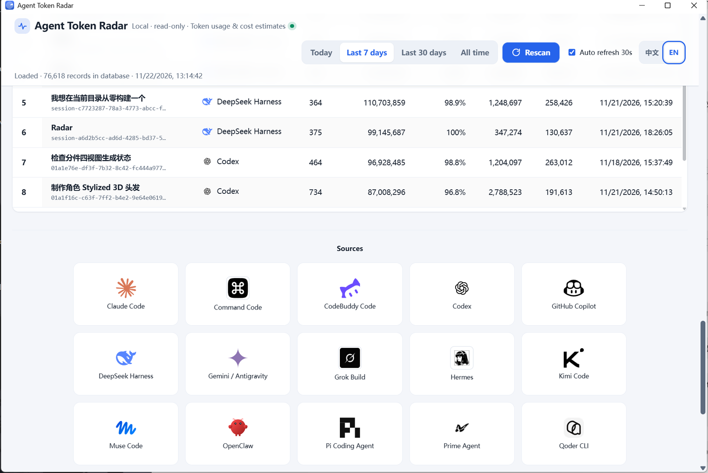

# Agent Token Radar

[简体中文](README.md) ｜ **English**

Measures **token usage** for every AI agent on your machine and turns it into a
**reference cost estimate** at the vendor's own list prices. It scans each
agent's session logs / SQLite read-only, normalises everything into one local
database, and serves it through a CLI report and a local web dashboard.

**25 agents · Chinese/English · local data · read-only · network only to check for updates**

<p>
<a href="#install"><b>↓ Install</b></a> ·
<a href="#usage"><b>↓ Usage</b></a> ·
<a href="#changelog"><b>↓ Changelog</b></a> ·
<a href="#what-this-is-based-on"><b>↓ What this is based on</b></a> ·
<a href="#scope-and-limits"><b>↓ Scope and limits</b></a>
</p>



> **Tokens are measured; cost is derived.** A cost is always `tokens × official
> list price`, so it can never be more trustworthy than the price table. The
> dashboard therefore always shows the **coverage ratio** next to any amount, and a
> model with no published price is reported as *unpriced* rather than counted as
> zero. Details in [PRICING-NOTES.md](PRICING-NOTES.md).

---

## The interface

All screenshots below are the **packaged desktop app** running against this
machine's real scan results — not sample data.

**Summary and trend** — total tokens, cache-hit rate, input / output / cache read /
reasoning, plus the reference cost and the share of tokens it covers, over a
per-day trend stacked by agent.


**Usage by Model** — every agent broken down by Model and Provider, with the
per-1M unit price and the peak/off-peak marking.



**Top Sessions by usage** — session titles come from each agent's own records, so
you see the real conversation names.



---

## What it does

| | |
|---|---|
| **25 agent adapters** | Claude Code, Codex, DSH, Gemini / Antigravity, Hermes, WorkBuddy, Kimi, Copilot, Qoder, Qwen Code, Pi, Prime, CodeBuddy, Command Code, Devin, MiMoCode, MiniMax, OpenCode, ZCode, Muse and more |
| **Six dimensions** | by Agent / Model / Provider / project (working directory) / Session / day |
| **Usage calendar** | a whole year as one heatmap, a square per day; days are shaded in five bands by rank, hover for that day's tokens and cost, click a day to focus it |
| **Cache-hit rate** | aggregated first, then divided; per-row ratios are never averaged (see [DESIGN.md](DESIGN.md)) |
| **Reference cost** | from official list prices, including time-of-day billing (DeepSeek peak/off-peak is decided per request from that request's own timestamp) |
| **Strict bilingual UI** | Chinese mode shows Chinese only, English mode English only |
| **Official icons** | all 25 use the vendor's own mark, embedded as SVG, works offline |
| **Desktop build** | a Windows installer needs no Python at all |

---

## Install

### Windows desktop build (recommended)

Download **`AgentTokenRadar-Setup.exe`** from
[Releases](https://github.com/Zhucy123/agent-token-radar/releases) and run it:

- Installs to `C:\Program Files\AgentTokenRadar`; asks for administrator once
- Creates a Start-menu shortcut; the desktop icon is an optional checkbox
- Uninstall via *Settings → Apps*; your usage database is **kept**, so reinstalling keeps your history
- No Python, no terminal — it scans automatically on first launch

> **The install path must be pure ASCII.** The window is pywebview + Edge
> WebView2, whose .NET runtime resolves native DLL paths as ANSI; a non-ASCII
> path fails with `Failed to resolve Python.Runtime.Loader.Initialize`. The
> installer checks for this and refuses a non-ASCII target.

### pip

```bash
# CLI only — pure standard library, no third-party packages
pip install "agent-token-radar @ git+https://github.com/Zhucy123/agent-token-radar"

# with the web dashboard (fastapi + uvicorn)
pip install "agent-token-radar[web] @ git+https://github.com/Zhucy123/agent-token-radar"
```

Requires Python **3.11+**. DSH's `.zstd` session logs decompress with the
standard library on 3.14+; on 3.11–3.13 add `pip install zstandard` (or fall
back to `.jsonl` only).

### From source

```bash
git clone https://github.com/Zhucy123/agent-token-radar
cd agent-token-radar
pip install -e ".[web]"          # for the desktop window also: pip install pywebview
python -m agent_token_radar serve
```

---

## Usage

```bash
agent-token-radar scan                          # scan once
agent-token-radar stats --range 7d --by agent   # terminal report
agent-token-radar stats --range all --by model  # by model
agent-token-radar stats --range all --by project
agent-token-radar serve                         # dashboard at http://127.0.0.1:8770
agent-token-radar desktop                       # native desktop window
```

Works from any directory once installed.

**Database location**

| Platform | Path |
|---|---|
| Windows | `%LOCALAPPDATA%\agent-token-radar\token_radar.db` |
| Linux | `~/.local/share/agent-token-radar/token_radar.db` |

Override with `AGENT_TOKEN_RADAR_DB`.

**Ports**: 8770 first, then 8771, 8772… if taken, and it tells you which port it
used. Add `--no-fallback` to fail instead of moving.

**Language**: `stats --lang en`, the `中文 / EN` toggle in the dashboard, or the
URL parameter `?lang=en`.

---

## What this is based on

This is not invented from scratch. Three sources shaped it, and every
non-obvious decision in the code carries its source.

### [cclank/tokei](https://github.com/cclank/tokei) — agent coverage and parsing rules

| Borrowed | How |
|---|---|
| **Agent coverage** | All 25 adapters follow tokei's supported list; agents tokei cannot measure (Cursor, Grok Bot, Doubao Work) were deliberately not added |
| **Two input conventions** | `Additive` (input excludes cache) vs `Inclusive` (input already contains cache, so subtract); each adapter declares which one it is instead of guessing |
| **reasoning is a subset of output** | Reported separately, never added into the total |
| **Copilot counts output only** | The upstream input/cache relationship is unsettled, so it stays blank rather than guessed |
| **Deduplication keys** | `event_key` uses each agent's natural request id, not a line number |
| **Official icons** | All 25 vendor marks, none drawn by hand |

**Where this deliberately differs**: when tokei has no price for a model it
falls back to "same tier, previous version" or a floor price. This tool does
not — no official price means no cost, so coverage stops at 96.5% instead of
being padded to 100%. An invented number is worse than an admitted gap.

Per-agent parsing details are in [TOKEI-NOTES.md](TOKEI-NOTES.md).

### [magpie](https://magpie.im) local gateway — session titles and measured providers

On this machine Claude Code and Codex traffic goes through a magpie gateway. Its
own records are closer to "what actually happened" than any agent log, so they
are used as a **measurement source**:

| Borrowed | How |
|---|---|
| **Where session titles live** | DSH in `ledger.json` under `days.<date>.sessions[]`; WorkBuddy in the `sessions` table of `workbuddy.db` |
| **Provider measured, not inferred** | Claude Code logs carry no provider field, but its `message.id` is the gateway's `responseId`, so requests pair up one-to-one |
| **Routing ledger beats export log** | The gateway's `routing/*.jsonl` is a per-request record and outranks the exported log |

**Evidence strength**: 587 matched requests agreed with the gateway's own
input/output token figures **exactly, 0 mismatches**.

> **magpie is not required.** Without it, provider falls back to *inferred* or
> blank, and the UI says so explicitly rather than presenting a guess as fact.

Not borrowed: magpie's local install holds no price or cost records, so there
was no pricing implementation to learn from.

### Vendor pricing pages — the cost estimate

Every price is read by hand from the vendor's official page, with the source URL
and the date it was read recorded alongside:

| Vendor | Source |
|---|---|
| DeepSeek | <https://api-docs.deepseek.com/quick_start/pricing> |
| OpenAI | <https://developers.openai.com/api/docs/pricing> |
| Anthropic | <https://platform.claude.com/docs/en/about-claude/pricing> |
| Kimi | <https://platform.kimi.ai/docs/pricing/chat> |
| Zhipu | <https://docs.z.ai/guides/overview/pricing> |
| Qwen | <https://www.alibabacloud.com/help/en/model-studio/qwen3-8-flash> |

All prices are the vendor's own **USD** page; no exchange rate is applied
anywhere. Repricing is a data edit in `agent_token_radar/pricing.json`, never a
code change.

---

## Documentation

| File | Contents |
|---|---|
| [DESIGN.md](DESIGN.md) | Full technical write-up: how the cache-hit rate is computed, per-agent input semantics, architecture and trade-offs |
| [PRICING-NOTES.md](PRICING-NOTES.md) | Pricing rules: where prices come from, why unpriced is not zero, how time-of-day billing works |
| [TOKEI-NOTES.md](TOKEI-NOTES.md) | tokei research and per-agent parsing spec |
| [BUILD-NOTES.md](BUILD-NOTES.md) | The packaging process and the 14 traps hit along the way |

The documents above are written in Chinese; the code and its comments are in
English.

---

## Development

```bash
# tests (PYTHONPATH must point at tests/)
PYTHONPATH=tests python -m unittest discover -s tests -p 'test_*.py'   # 293 tests

# scan smoke test
python -m agent_token_radar scan

# build the Windows installer
python -m PyInstaller --noconfirm agent-token-radar-dir.spec   # -> dist/AgentTokenRadar/
ISCC.exe agent-token-radar.iss                                  # -> dist-installer/AgentTokenRadar-Setup.exe
```

### Adding an agent

Drop a `.py` file containing `class XxxAdapter(BaseAdapter)` into `adapters/` and
it is **registered automatically** — there is no central list to edit. Implement
`name`, `detect()` and `scan(checkpoint)`, and keep `event_key` stable so a
repeated scan upserts instead of double-counting.

---

## Changelog

### 0.0.6

**Added**

- **A year-long usage calendar**: a heatmap above the trend chart, one square per
  day. Days with records are shaded in five bands by rank, so the shape of the
  year is visible at once; hovering or focusing a square shows that day's tokens,
  cost and pricing coverage. Clicking a day jumps to it.
- The calendar pages back through earlier years, and the arrow keys move within
  the year. The whole year is a single tab stop, so it does not bury everything
  after it.

**Fixed**

- **On a narrow window the calendar opened on a screen of empty squares.** The
  year is wider than the window and a scroller starts at its left edge —
  January — where a fresh year usually holds nothing. It now parks on the
  window of weeks holding the **most active days**.
- **The calendar looked blurry**: the palest band was a 1px inner ring, which
  turns into a grey halo at fractional display scales. It is a solid fill now,
  and the weekday and month labels line up with the rows and columns they name.
- **Changing the text size left the calendar parked on the old columns**: the
  squares are sized in rem, so a new text size means a new column width and a
  different number of columns that fit. The old code judged this from a derived
  value rather than a measurement and got a 14px pitch where the boxes said
  17.594px, parking the panel at 84px — showing 50 of the year's 94 active days.
  It now reads the measured pitch and re-places on a font-size change itself.

### 0.0.5

**Added**

- **Yesterday**: a new **Yesterday** button sits beside Today, Last 7 days and
  the rest of the presets.
- **Pick any date range**: the date button always spells out the window on screen
  (for example "11-18 to 11-24"); clicking it opens a picker for any start and
  end, or a single day. Applying a custom range clears the preset buttons, so
  "Last 7 days" is never lit while the chart shows three days.
- **Click a day in the trend chart to focus on it**: anywhere in that day's
  column counts, not just the bar, and the date button updates to that day.
- **Full or shortened numbers**: a new toolbar switch. **Full** shows the exact
  figure (`2,967,603,835`); **Short** abbreviates with 万/亿 in Chinese or
  K/M/B in English, following the interface language. The choice is remembered
  across reloads.

**Fixed**

- **Picking a window with no data left the previous chart and tables on screen.**
  The legend, y-axis ticks, share list and bars are now cleared, and the table
  says this window is empty instead of suggesting a rescan — the scan has already
  run.
- **Long numbers in the summary cards were cropped.** Two causes: the type size
  grew with the window while seven cards share ~190px each, and the card's own
  `overflow: hidden` zeroed its minimum width so a long number could not widen
  it. Cards are now equal-width and tidy, and a figure that still does not fit is
  shrunk inside its own card — never cropped, and never forcing a horizontal
  scrollbar.
- **"Yesterday" used to return the whole history** (92 days, ~81k events),
  because the backend did not recognise the range and silently fell back to
  "all". Unknown ranges are now reported as an error instead.

**Note**

- The CLI's `--range` accepts `yesterday` too, matching the dashboard.
- On a language switch, the card suffixes, the date label and the picker's
  validation message all follow the new language.

### 0.0.4

**Added**

- **Update in place** (installed build): "Download" is now an accent-coloured
  "Update now" primary button. Clicking it downloads the installer, checks its
  size, runs it, deletes the download afterwards and reopens the app on the new
  version — no trip to the browser.
- **Nothing runs until the file has fully arrived**: the download is written under
  a `.part` name and only renamed once complete, so a crash cannot leave a
  truncated file that looks installable.
- **Leftovers are swept at startup**, so a machine rebooted mid-update does not
  accumulate old 18 MB installers.

**Note**

- **Windows always shows one permission prompt, and that step cannot be
  skipped** (the installer writes to Program Files). The panel says so *before*
  you click, rather than letting it look like a failure afterwards. Download,
  size check, install, cleanup and relaunch are all automatic.
- A source checkout does not take this path: the panel tells you to update with
  `git pull` and never fetches an installer.
- Safety, since this runs a downloaded executable: HTTPS only (a downgrade would
  let anything on the path swap the binary), the installer size published in the
  release is compared (which tells a cut-off transfer or a proxy error page apart
  from a real installer), the download lands in the per-user directory rather
  than the install directory, and it is launched without a shell (so a path with
  spaces is not split).

### 0.0.3

**Added**

- **Update check**: the toolbar shows your running version (for example
  `v0.0.3`); open it to see whether a newer one exists. When an update is
  available the button takes the accent colour and shows a dot, so you know
  without opening anything. It runs once in the background at startup and caches
  the answer for 24 hours (at most one request a day), reading only a version tag
  and sending nothing about you.

**Note**

- This is the project's **only network access**. The earlier "no network
  requests" claim no longer holds, and the README and DESIGN text has been
  corrected accordingly.
- Set `AGENT_TOKEN_RADAR_NO_UPDATE_CHECK=1` to turn it off completely: no check
  at startup and none when you open the panel, so not a single request is made.

### 0.0.2

**Added**

- **Section jump bar**: six buttons across the top (Summary / Trend / By Agent /
  Agent / Model / By project / Top Sessions) that jump straight to that section.
  The current section highlights as you scroll, and the row still lines up when
  it wraps to two lines on narrow windows.
- **Text settings dialog** (gear icon, top right): four text sizes, 23 typefaces
  grouped into sans / serif / Chinese / monospace, four weight levels, italic,
  seven text colours and four outline widths. Changes apply immediately, survive
  a reload, and the first paint already uses the chosen size instead of flashing
  the default first.

**Fixed**

- **Cached input billed twice**: for agents that fold cache reads into their
  input count (Codex, WorkBuddy), the cached part was charged twice. Measured at
  the moment of the fix, the total went from $1875.84 to $374.47 and Codex alone
  from $1532.53 to $120.38. **Those are snapshots of that moment**; the figures
  keep moving as this machine logs more usage, so trust what your own install
  shows.
- **Highlight jumped ahead after a jump**: clicking a section highlighted the one
  below it, because the scroll spy treated the callback's changed-entries batch
  as the full set of visible sections.
- **English left in Chinese mode**: the "Top Session" jump label, the status
  dot's hover tooltip and the language switch's accessible name all stayed
  English; they now follow the selected language.
- **Chinese in monospace cells**: project names and session titles had no CJK
  fallback in their font stack, so Chinese fell back to the system face and
  looked different from the rest of the page. All 23 typeface options and the
  chart canvas were checked too.
- **Jump landing gap**: at larger text sizes the gap between the sticky bars and
  the jumped-to heading no longer matched the intended spacing.

### 0.0.1

First release: 25 agent adapters, a CLI, a single-page web dashboard, Chinese and
English, official brand icons, reference cost estimates from published prices,
and a Windows installer.

---

## Scope and limits

- **Cost is a reference estimate, not a bill.** Only models with a published
  price are costed; the rest are labelled and the coverage ratio is shown
- **Strictly read-only** towards every third-party agent directory — nothing is
  written, moved or deleted there
- **The only network access is the update check**: at startup it asks GitHub for
  the latest version tag and caches the answer for 24 hours, so it is at most one
  request a day. It reads a version tag and nothing else — **no usage data and no
  machine identifier is sent**. With no network, or GitHub unreachable, everything
  works exactly as before; you just see no update notice. Set
  `AGENT_TOKEN_RADAR_NO_UPDATE_CHECK=1` to switch it off entirely
- **The price table is hand-maintained static data**, not scraped at runtime
- **Unsigned**, so SmartScreen may warn "unknown publisher" on first run
- Windows installer only; on Linux use `pip install`

---

## License

MIT, see [LICENSE](LICENSE).

Third-party brand icons belong to their respective vendors and are used only to
identify the corresponding agent.
