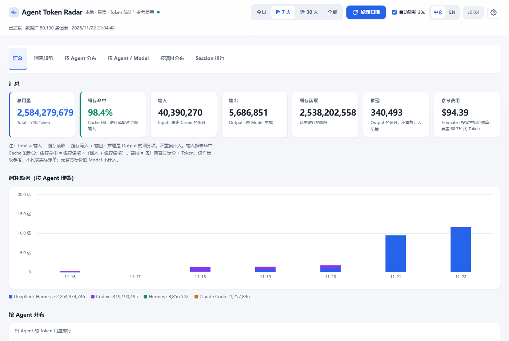
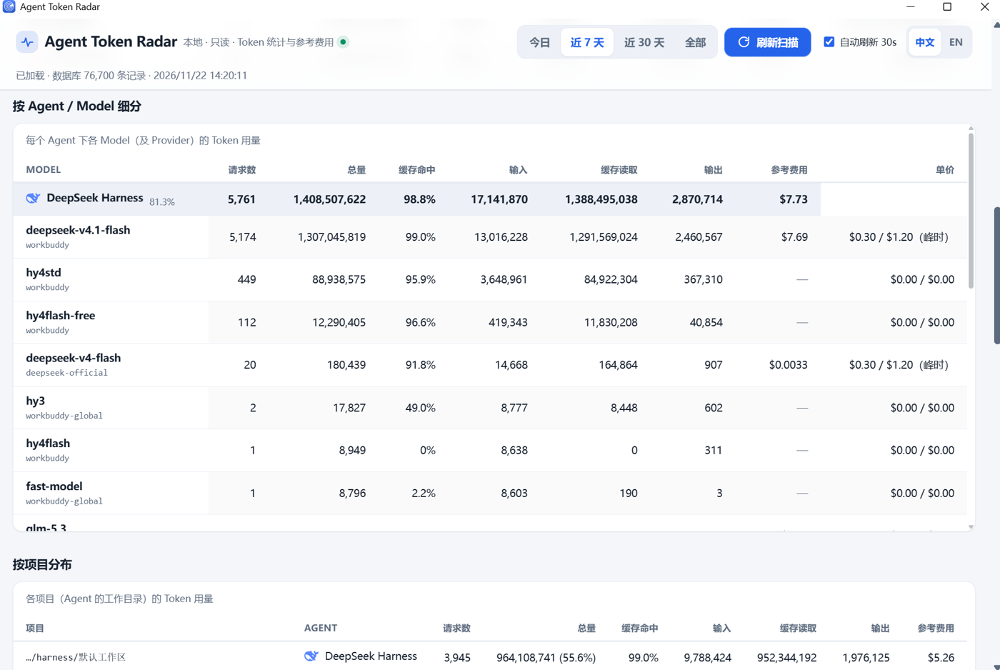

# Agent Token Radar

**简体中文** ｜ [English](README.en.md)

统计本机各个 AI Agent 的 **Token 用量**，并按厂商官方标价给出**参考费用估算**。
只读扫描本机会话日志 / SQLite，归一化入库，提供 CLI 报表与本地 Web 仪表盘。

**25 个 Agent · 中英双语 · 纯本地 · 无网络请求 · 只读**

<p>
<a href="#安装"><b>↓ 安装</b></a> ·
<a href="#使用"><b>↓ 使用</b></a> ·
<a href="#更新日志"><b>↓ 更新日志</b></a> ·
<a href="#参考了什么"><b>↓ 参考了什么</b></a> ·
<a href="#说明与边界"><b>↓ 边界说明</b></a>
</p>



> **Token 是测量值，费用是推导值。** 费用 = Token × 官方标价，可信度不会超过那张价格表。
> 因此界面**强制把覆盖率和金额一起显示**：没有公开标价的模型标成「无公开价」，绝不算成 0。
> 细节见 [PRICING-NOTES.md](PRICING-NOTES.md)。

---

## 界面

以下截图取自**实际安装的 Windows 桌面程序**（不是浏览器标签页）。

**汇总与趋势**：总用量、缓存命中率、输入/输出/缓存读取/推理六个指标，加参考费用与覆盖率，下面是按 Agent 堆叠的每日消耗趋势。


**按 Model 分布**：每个 Agent 下的各 Model（及 Provider）用量，含每百万 Token 单价与峰谷标注。



**消耗最高的 Top Session**：会话标题取自各 Agent 自己的记录，能看到真实的会话名。


---

## 功能

| | |
|---|---|
| **25 个 Agent 适配器** | Claude Code、Codex、DSH、Gemini / Antigravity、Hermes、WorkBuddy、Kimi、Copilot、Qoder、Qwen Code、Pi、Prime、CodeBuddy、Command Code、Devin、MiMoCode、MiniMax、OpenCode、ZCode、Muse 等 |
| **多维度统计** | 按 Agent / Model / Provider / 项目（工作目录）/ Session / 天 |
| **缓存命中率** | 先聚合再相除，不平均每行比率（详见 [DESIGN.md](DESIGN.md)） |
| **参考费用估算** | 按厂商官方标价，支持分时计价（DeepSeek 峰谷按每条请求自身时间判断） |
| **中英双语** | 严格分离，中文模式只显示中文 |
| **官方图标** | 25 个 Agent 全部用厂商官方标识，内嵌 SVG，离线可用 |
| **桌面版** | Windows 安装包，免 Python 环境 |

---

## 安装

### Windows 桌面版（推荐）

从 [Releases](https://github.com/Zhucy123/agent-token-radar/releases) 下载 **`AgentTokenRadar-Setup.exe`**，双击安装：

- 装到 `C:\Program Files\AgentTokenRadar`，安装时请求一次管理员权限
- 开始菜单自动建快捷方式，桌面图标是可选勾选项
- 卸载走「设置 → 应用」或控制面板，**保留**用量数据库（重装不丢历史）
- 无需 Python、无需命令行，打开即自动扫描

> **必须装到纯英文路径。** 界面用 pywebview + Edge WebView2，其 .NET 运行时加载原生 DLL 时按 ANSI 解析路径，中文路径会导致 `Failed to resolve Python.Runtime.Loader.Initialize`。安装程序会检查并拒绝非 ASCII 目标。

### pip 安装

```bash
# 只要 CLI —— 纯 Python 标准库，不装任何第三方包
pip install "agent-token-radar @ git+https://github.com/Zhucy123/agent-token-radar"

# 还要 Web 仪表盘（fastapi + uvicorn）
pip install "agent-token-radar[web] @ git+https://github.com/Zhucy123/agent-token-radar"
```

需要 Python **3.11+**。DSH 的 `.zstd` 会话日志在 3.14+ 用标准库解压；3.11–3.13 请加 `pip install zstandard`（或只用 `.jsonl` 回退）。

### 从源码运行

```bash
git clone https://github.com/Zhucy123/agent-token-radar
cd agent-token-radar
pip install -e ".[web]"          # 桌面版再加 pip install pywebview
python -m agent_token_radar serve
```

---

## 使用

```bash
agent-token-radar scan                          # 扫描一次
agent-token-radar stats --range 7d --by agent   # 终端报表
agent-token-radar stats --range all --by model  # 按 Model
agent-token-radar stats --range all --by project
agent-token-radar serve                         # 仪表盘 http://127.0.0.1:8770
agent-token-radar desktop                       # 原生桌面窗口
```

装好之后在任意目录都能运行。

**数据库位置**

| 平台 | 路径 |
|---|---|
| Windows | `%LOCALAPPDATA%\agent-token-radar\token_radar.db` |
| Linux | `~/.local/share/agent-token-radar/token_radar.db` |

用 `AGENT_TOKEN_RADAR_DB` 覆盖。

**端口策略**：8770 优先，被占用自动顺延到 8771、8772…… 启动时会明确告诉你在哪个端口。
想固定端口、被占即报错退出，加 `--no-fallback`。

**语言切换**：`stats --lang en`，或 Web 右上角 `中文 / EN`，或用 URL 参数 `?lang=en`。

---

## 参考了什么

这个项目不是从零发明的，三个方向各有明确的参照对象，每处「为什么这么实现」都标了出处。

### [cclank/tokei](https://github.com/cclank/tokei) — Agent 覆盖面与解析规格

| 借鉴点 | 具体做法 |
|---|---|
| **Agent 覆盖面** | 25 个适配器对齐 tokei 的支持列表；tokei 不支持的（Cursor、Grok Bot、Doubao Work）不擅自新增 |
| **两种 input 语义** | `Additive`（input 不含 cache）与 `Inclusive`（input 已含 cache 需相减），每个适配器显式声明，不靠猜 |
| **reasoning 是 output 的子集** | 单独报告，绝不加进 total |
| **Copilot 只统计 output** | 上游 input/cache 包含关系未定论，宁可留空也不猜 |
| **去重键设计** | `event_key` 用各 Agent 天然的请求 id，而不是行号 |
| **官方图标** | 25 个全部官方标识，无一自绘 |

**刻意不跟随的部分**：tokei 缺价时会「沿用同档位上一版或兜底价」，本项目**不这样做**——查不到官方价就不算，代价是覆盖率停在 96.5% 而不是 100%。一个编出来的价格比一个承认的缺口更糟。

逐 Agent 解析规格见 [TOKEI-NOTES.md](TOKEI-NOTES.md)。

### [magpie](https://magpie.im) 本机网关 — 会话标题与 provider 的真实来源

本机 Claude Code / Codex 的流量经过 magpie 网关，它自己的记录比任何 Agent 日志都更接近「真实发生了什么」，因此被当作**实测来源**：

| 借鉴点 | 具体做法 |
|---|---|
| **会话标题怎么读** | DSH 在 `ledger.json` 的 `days.<日期>.sessions[]`；WorkBuddy 在 `workbuddy.db` 的 `sessions` 表 |
| **provider 实测优先** | Claude Code 日志没有 provider 字段，但它的 `message.id` 就是网关的 `responseId`，逐请求对上即可 |
| **路由账本优先** | 网关的 `routing/*.jsonl` 是逐请求账本，比导出日志更权威 |

**证据强度**：587 条匹配请求的 input/output token 与网关记录**逐条完全一致，0 条不符**。

> **注意**：本项目**不需要** magpie 也能工作。没有网关时 provider 会退回「推断」或留空，界面会明确标出来，不会把猜测当事实。

未跟随 magpie 定价相关：magpie 本机安装里没有价格 / 费用记录，无可参考的定价实现。

### 厂商官方定价页 — 费用估算

价格全部手工取自厂商官方定价页，每条都记了来源 URL 和读取日期：

| 厂商 | 来源 |
|---|---|
| DeepSeek | <https://api-docs.deepseek.com/quick_start/pricing> |
| OpenAI | <https://developers.openai.com/api/docs/pricing> |
| Anthropic | <https://platform.claude.com/docs/en/about-claude/pricing> |
| Kimi | <https://platform.kimi.ai/docs/pricing/chat> |
| Zhipu | <https://docs.z.ai/guides/overview/pricing> |
| Qwen | <https://www.alibabacloud.com/help/en/model-studio/qwen3-8-flash> |

币种一律用官网**美元价**，任何地方都不做汇率换算。厂商调价只改 `agent_token_radar/pricing.json`，不改代码。

---

## 文档

| 文件 | 内容 |
|---|---|
| [DESIGN.md](DESIGN.md) | 完整技术文档：缓存命中率怎么算、各 Agent 的 input 语义差异、架构与取舍 |
| [PRICING-NOTES.md](PRICING-NOTES.md) | 定价口径：官方价来源、为什么无价不算 0、分时计价怎么实现 |
| [TOKEI-NOTES.md](TOKEI-NOTES.md) | tokei 调研与逐 Agent 解析规格 |
| [BUILD-NOTES.md](BUILD-NOTES.md) | 打包过程与 14 个坑的记录 |
| [HANDOFF.md](HANDOFF.md) | 给接手者的入口说明 |

---

## 开发

```bash
# 测试（需要 PYTHONPATH 指向 tests）
PYTHONPATH=tests python -m unittest discover -s tests -p 'test_*.py'   # 223 个测试

# 扫描冒烟
python -m agent_token_radar scan

# 打包 Windows 安装包
python -m PyInstaller --noconfirm agent-token-radar-dir.spec   # -> dist/AgentTokenRadar/
ISCC.exe agent-token-radar.iss                                  # -> dist-installer/AgentTokenRadar-Setup.exe
```

### 加一个新 Agent

在 `adapters/` 放一个含 `class XxxAdapter(BaseAdapter)` 的 `.py` 文件即可**自动注册**，无需改任何中心列表。
必须实现 `name`、`detect()`、`scan(checkpoint)`，并保证 `event_key` 稳定（重复扫描靠 UPSERT 幂等）。

---

## 更新日志

### 0.0.2

**新增**

- **页面跳转栏**：顶部一排六个按钮（汇总 / 消耗趋势 / 按 Agent 分布 / 按 Agent / Model / 按项目分布 / Session 排行），点击直达对应区块。滚动时自动高亮当前区块，窄窗口按钮折成两行仍能对齐。
- **文字设置窗口**（右上角齿轮）：字号 4 档、字体 23 种（按无衬线 / 衬线 / 中文 / 等宽分组）、字重 4 档、倾斜、文字颜色 7 种、描边 4 档。改完立即生效、刷新后保留，且首屏直接以设定值渲染，不会先闪一下默认样式。

**修复**

- **费用重复计费**：Codex、WorkBuddy 这类把缓存读写合并计的 Agent，缓存部分被收了两次钱。总额由 $1875.84 修正为 $374.47，其中 Codex 由 $1532.53 降到 $120.38。
- **跳转后高亮错位**：点某个区块后，高亮会跳到下一个区块。原因是滚动监听把「本轮状态变化」当成了「当前可见的全部章节」。
- **中文模式残留英文**：跳转栏的「Top Session」、状态点的鼠标悬停提示、语言切换按钮的无障碍名，此前在中文模式下仍是英文，现在都跟随语言切换。
- **等宽字体的中文**：项目名、Session 标题等使用等宽字体的位置没有中文兜底，中文会回落到系统默认字体，与页面其他文字不一致；23 种字体选项与画布图表也逐项确认过。
- **跳转落点间距**：文字调大后，跳转落点的实际间距与设定值不一致。

### 0.0.1

首个发布版本：25 个 Agent 适配器、CLI、单页 Web 仪表盘、中英双语、官方图标、按官方标价估算参考费用、Windows 安装包。

---

## 说明与边界

- **费用是参考估算，不是账单。** 按官方标价折算，只覆盖有公开价的模型；无价的如实标注并单独显示覆盖率
- **对第三方目录严格只读**，不写入、不删除、不修改任何 Agent 自己的数据
- **不联网**，价格表是手工维护的静态数据
- **未签名**，首次运行 SmartScreen 可能提示「未知发布者」
- 只有 Windows 安装包，Linux 目前用 `pip install`

---

## 许可证

MIT，见 [LICENSE](LICENSE)。

第三方品牌图标归各自厂商所有，仅为标识对应 Agent 而使用。
